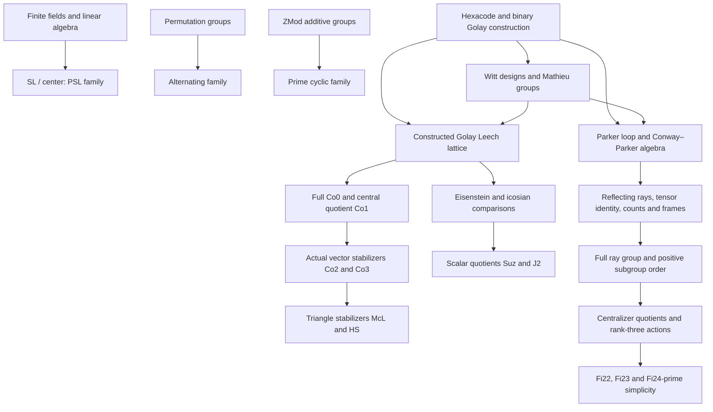

# Mathematical dependency account

The exact edge convention in DEPENDENCIES.json is **declaration → referenced constant**. `type` and `value` list direct references separately; `dependencies` is their union together with inductive/recursor metadata where relevant. Opaque values are included. All reachable constants, including private helpers and implicit instances, are retained. Local hypotheses are binders in THEOREM_STATEMENTS.txt, not fabricated graph nodes or omitted axiom assumptions. Module imports in IMPORTED_MODULES.txt are a distinct graph and usually much broader than one theorem's dependencies.

This overview groups actual project stages. An arrow below describes a construction route, not the assertion that every result in the preceding group namespace is used. CROSS_GROUP_DEPENDENCIES.csv provides exact earlier order/simplicity/count references for each principal root; EXTERNAL_THEOREMS.csv lists the external mathematical theorem dependencies.

## Verified structural interfaces

| Entries | Significant structures retained in the public declarations |
|---|---|
| Cyclic | Cyclic generator and its order; regular faithful translation action; prime/simple equivalence and commutative simple-group comparison |
| Alternating | Three-cycle generation, natural faithful multiply transitive action, pointwise stabilizers, index-two inclusion in the symmetric group |
| PSL | Exact scalar centers, elementary generation, faithful doubly transitive primitive projective action, PSL→PGL injection, determinant/nth-power diagonal quotient and prime-power existence |
| Mathieu | Actual Golay/Witt code and design models, sharp or multiple transitivity, block counts/Steiner interfaces, compatible stabilizer embeddings |
| Conway | Actual full Leech isometry group and center, quotient and vector stabilizers, faithful primitive lattice geometries, local subgroup structure and integral representations |
| McL, HS | Actual triangle stabilizers, geometric actions and full local stabilizers, order identities, simplicity and compatible Conway embeddings |
| Suz, J2 | Actual scalar-lattice comparisons with the retained Leech lattice, full linear centralizers/stabilizers, distinct scalar kernels and centers, frame/point geometries and quotient simplicity |
| Fischer | Actual 783-dimensional Conway–Parker algebra, reflecting rays and product/tensor identities, faithful ray action, frame/stabilizer counting, actual centralizer quotients, rank-three residue actions, perfectness and simplicity |

PROPERTIES.csv is a public-interface inventory backed by 607 selected roots, not a claim of 607 independent new mathematical achievements. It includes aliases, transported interfaces and small public checks. Exact assumptions and maps are in the statement report, and the dependency graph distinguishes wrapper theorems from underlying work. Full internal comparisons do not imply an external recognition theorem characterizing arbitrary finite simple groups from order alone.

## Imported mathematics and independence

The closures use mathlib's finite-field and cyclic-group theory, matrix groups, subgroup/quotient/index theory, permutation groups, Sylow theory, solvability and nilpotence, linear algebra, cardinality, and general group-action simplicity criteria. Concrete imported simplicity results include `isSimpleGroup_of_prime_card`, `alternatingGroup.isSimpleGroup`, and `MulAction.IwasawaStructure.isSimpleGroup`. The low-rank PSL development also reuses the pinned mathlib rank-two result; the higher-rank projective/elementary proof is ATLAS mathematics. EXTERNAL_THEOREMS.csv provides the actual names rather than treating all imported modules as used.

No global CFSG/exhaustiveness or order-recognition theorem is identified in the extracted closures. Local results with “classification” in their names—such as marked pentad/frame classification—classify configurations in already constructed objects, rather than assume a finite simple group from the CFSG list. The graph and exact hypotheses expose their inputs. This is evidence for construction independent of an imported global classification theorem; it is not an independent reconstruction/review of every informal historical argument behind every library lemma.

No externally trusted GAP/Magma/Sage/Python result or native evaluator axiom enters the selected closures. Candidate matrices, finite configurations and ordinary kernel-checkable reductions remain possible mathematical computational inputs. Absence of external computational trust and CFSG independence do **not** imply a computer-free proof. This audit has not reconstructed a universal provenance history for all finite tables or separately rerun every historical shard certificate; their used compiled checking theorems are present in the graph.

For Fischer, the algebra is the actual elementary Conway–Parker construction over the retained scalar field, with Golay/Parker inputs. There is no asserted VOA/Moonshine identification in this audit. The simple quotient, its full ray-group extension, its triple linear cover and full semilinear group are different objects. The additional extension certificates remain available in the original verification tree; this audit checks the selected public interfaces and all dependencies actually reached, not every historical certificate as a separate new run.
